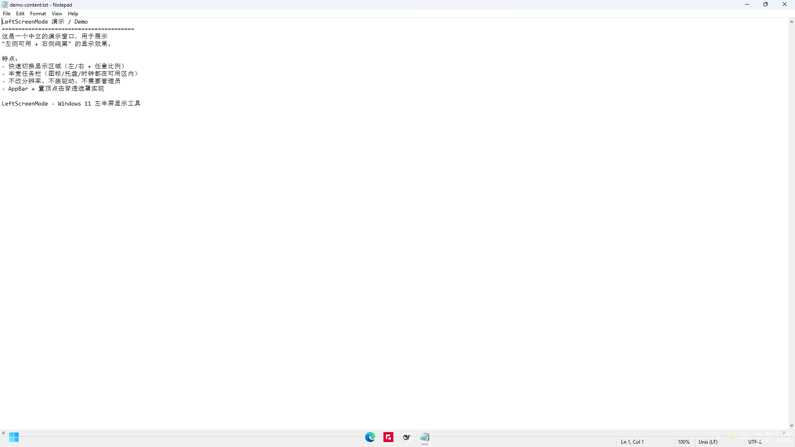
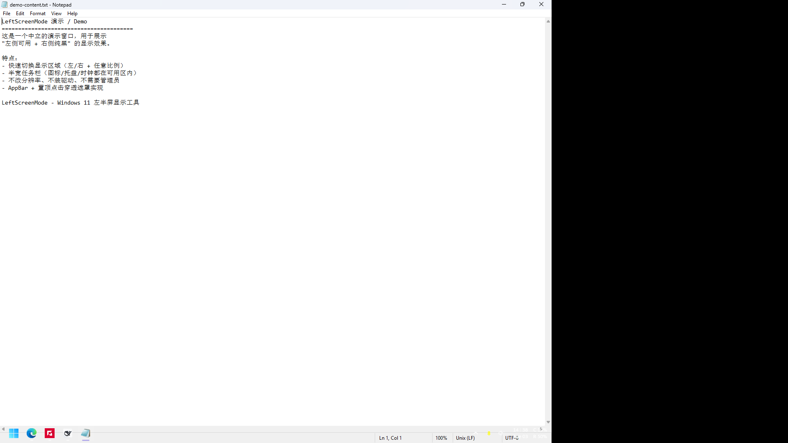
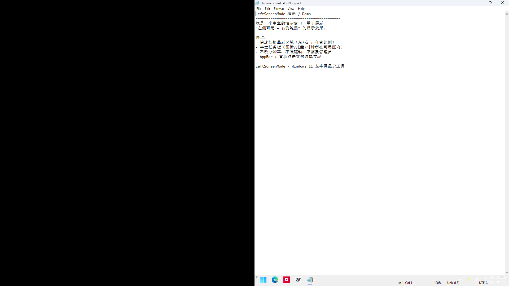

# LeftScreenMode

**让 Windows 11 只使用屏幕的一部分（例如左半屏），另一侧用纯黑遮住** —— 适用于屏幕一侧被物理遮挡、或需要把工作区域限制在屏幕某一部分的场景。支持左/右任一侧、任意比例、快速热键，**不修改分辨率、不装驱动、不需要管理员权限**。

> English: Use only a portion of your Windows 11 screen (e.g. the left half) with the rest blacked out. Choose left/right side and any width, switch with quick hotkeys, and the taskbar shrinks to the same area. No driver/EDID/resolution changes, no admin required.

## 效果

| 全屏正常 | 左侧可用 70%（右侧 30% 黑） |
|---|---|
|  |  |

| 右侧可用 50%（左侧一半黑） |
|---|
|  |

> 截图中的窗口与任务栏都是工具实际效果：可用区域收缩、另一侧纯黑、任务栏也缩到同一宽度。

## 功能特性

- **可用区域**：左侧或右侧任选一侧，宽度 **10–100%** 任意比例（`left:70`、`right:50`、`--percent 45`…）；100% 等于全屏。
- **半宽任务栏**：任务栏也缩到可用区域宽度，开始按钮 / 应用图标 / 托盘 / 时钟都在可用区域内。
- **快速切换**（默认热键）：
  - `Win+Ctrl+L` 后按数字 → **左侧可用**，数字为百分比（`7`=70%，不按=50%，`0`=100%）；
  - `Win+Ctrl+R` 后按数字 → **右侧可用**；
  - `Win+Ctrl+0` → **切回全屏**；`Esc` 取消数字选择。
- **托盘菜单**：显示区域预设（30/40/50/60/70/80%）、自定义百分比对话框、开机自启、重新应用。
- **命令行 / 快捷方式**：`--on`、`--off`、`--toggle`、`--preset left:70`、`--percent 60`、`--side left|right`、`--info`。
- **原生最大化约束**：通过 Windows AppBar 机制让系统自己收缩工作区，窗口最大化 / `Win+方向键`贴靠自动限制在可用区域，无需 Hook 其他程序。
- **窗口迁移与恢复**：进入时把窗口移入可用区域，退出时精确恢复原始位置与最大化状态。
- **任务栏图标对齐兼容**：半屏时临时改为左对齐（避免 Windows/Windhawk 的“居中”按整屏宽度计算导致错位），退出后恢复原设置。
- **健壮性**：崩溃或强杀后工作区自动恢复；启动时自动修复残留的任务栏/对齐状态。
- **零依赖**：单个 exe，无需安装、不联网、不写系统服务；仅使用系统自带 .NET Framework 4.x。

## 快速开始

### 方式 1：下载可执行文件

到本仓库的 [Releases](../../releases) 页面下载最新 `LeftScreenMode-v*.zip`，解压后双击 **`LeftScreenMode.exe`** 即可（免安装）。

### 方式 2：自行编译

需要 Windows 自带的 .NET Framework 4.x（Win10/11 默认已有），无需安装 SDK：

```powershell
powershell -ExecutionPolicy Bypass -File .\build.ps1
```

产物为根目录的 `LeftScreenMode.exe`。

### 使用

1. 双击 `LeftScreenMode.exe` → 驻留系统托盘（启动时左上角会显示提示窗）。
2. 按 `Win+Ctrl+L` 再按数字（如 `7`）→ 左侧可用 70%；`Win+Ctrl+0` 切回全屏。
3. 托盘右键可打开「显示区域」菜单快速选比例；双击托盘图标可在左侧/全屏之间切换。
4. 退出：托盘右键 → 退出（会自动恢复所有设置）。

> 提示：程序默认复用你原本的任务栏自动隐藏设置；鼠标移到屏幕底部可用区域一侧即可看到半宽任务栏。

## 热键

| 热键 | 功能 |
|---|---|
| `Win+Ctrl+L` + 数字 | 左侧可用；`1`~`9` = 10%~90%，`0` = 100%，不按数字 = 50% |
| `Win+Ctrl+R` + 数字 | 右侧可用（规则同上） |
| `Win+Ctrl+0` | 切回全屏 |
| `Esc` | 取消正在输入的比例 |
| 托盘双击 | 左侧模式 / 全屏模式切换 |

- 数字可连按形成多位百分比（如 `4`、`5` → 45%；超过 100 按 100 计算）。
- `Win+Ctrl+L` 是 Windows 11「实时字幕」的系统快捷键、`Win+Ctrl+0` 也被其它程序注册，普通方式无法占用，因此程序使用低级键盘钩子接管（运行本工具时这两个系统快捷键会被本工具使用）。如果不想接管，可在 `LeftScreenMode.ini` 中设置 `UseKeyboardHook=0` 并改用备用组合键（如 `Win+Alt+L`、`Win+Ctrl+F12`）。

## 配置

首次运行会在 exe 同目录生成 `LeftScreenMode.ini`；仓库提供了示例文件 [`LeftScreenMode.ini.example`](LeftScreenMode.ini.example)。常用配置：

| 配置项 | 说明 |
|---|---|
| `Monitor` | 目标显示器：`auto`（主屏）、`\\.\DISPLAY1` 或显示器硬件 ID 关键字 |
| `LeftAreaPercent` | 可用区域宽度百分比（10–100） |
| `CoverSide` | `right`=左侧可用（遮右侧）；`left`=右侧可用（遮左侧） |
| `Presets` | 托盘「显示区域」菜单里的百分比列表 |
| `HotkeyLeftLayout` / `HotkeyRightLayout` | 左右比例热键组合（默认 `Win+Ctrl+L` / `Win+Ctrl+R`） |
| `HotkeyFullScreen` | 切回全屏的快捷键（默认 `Win+Ctrl+0`） |
| `LayoutDigitTimeoutMs` | 按组合键后等待数字的时间（毫秒） |
| `UseKeyboardHook` | 是否用键盘钩子识别/接管热键（默认 `1`） |
| `HalfTaskbar` | 任务栏是否缩成可用区域宽度（默认 `1`） |
| `LeftAlignTaskbarIcons` | 半屏时任务栏图标是否临时左对齐（默认 `1`） |
| `MoveWindows` | 是否把窗口移入可用区域（默认 `1`） |
| `OverlayOpacity` / `OverlayColor` | 遮罩不透明度 / 颜色 |
| `StartInLeftMode` | 启动时是否直接进入左侧模式 |
| `HotkeyFullScreen` 等 | 见完整示例文件 |

## 命令行

```
LeftScreenMode.exe                 启动托盘程序（默认全屏）
LeftScreenMode.exe --on            启动并切换到左侧模式
LeftScreenMode.exe --off           关闭左侧模式，恢复正常全屏
LeftScreenMode.exe --toggle        切换（托盘双击/脚本可用）
LeftScreenMode.exe --preset left:70    左侧可用 70%
LeftScreenMode.exe --preset right:50   右侧可用 50%
LeftScreenMode.exe --percent 60        只改百分比
LeftScreenMode.exe --side left         只改可用侧（left=左侧可用）
LeftScreenMode.exe --info          查看显示器/工作区/任务栏/热键状态
LeftScreenMode.exe --status        输出 enabled / disabled / stopped
LeftScreenMode.exe --quit          退出并恢复所有设置
```

## 已知限制

- **独占全屏（DirectX exclusive fullscreen）**：覆盖窗无法显示，游戏仍按整屏渲染；请使用无边框窗口/窗口模式。
- **无边框全屏视频/浏览器 F11**：遮罩会盖住不可用侧，相当于画面被裁掉一部分；建议用窗口模式。
- **任务栏右下角通知/时钟**：位于不可用区域时会被遮罩盖住（本工具场景下通常也是物理遮挡区）。
- **任务栏图标居中**：Windows 的居中布局以整屏宽度为基准，缩窄任务栏后会错位；因此半屏默认临时改为左对齐，退出恢复（兼容 Windhawk 的居中方案，但半屏内无法保持真正的“居中”）。
- **仅水平方向**：目前只支持左右分割，不支持上下分割。
- **热键接管**：`Win+Ctrl+L`（实时字幕）/`Win+Ctrl+0` 被系统或其它程序占用，默认用键盘钩子接管；可在配置中关闭并改用备用组合键。
- **多显示器**：默认只作用于主显示器，可用 `Monitor` 指定；任务栏相关效果只针对主显示器的任务栏。

## 工作原理（简述）

1. **AppBar 收缩工作区**：把黑色遮罩窗口注册为 Windows AppBar（与任务栏同一机制），系统会自己把该侧的“工作区”让出来 → 最大化/贴靠/新窗口都只发生在可用区域。
2. **纯黑遮罩**：无边框、置顶、点击穿透、不抢焦点的窗口盖住不可用区域。
3. **任务栏半边**：Windows 11 任务栏窗口本身被系统强制全宽，但真正绘制内容的是其 XAML 子窗口；缩放该子窗口即可让开始按钮/图标/托盘/时钟重排到可用宽度，并加裁剪区域避免不可点击残留。系统重置时会自动补回。
4. **窗口迁移/恢复**：记录窗口原始 `WINDOWPLACEMENT`，移入可用区域；退出时精确恢复。
5. **任务栏对齐**：半屏时临时切 `TaskbarAl=0`（左对齐）并广播设置变更（无需重启 Explorer），退出恢复原值。

详见 [调研报告.md](调研报告.md) 与 [`research/`](research/) 下的原始调研记录。

## 项目结构

| 路径 | 说明 |
|---|---|
| `src/LeftScreenMode.cs` | 主程序（托盘、热键、遮罩、任务栏、窗口管理） |
| `src/Native.cs` | Win32 / AppBar / 键盘钩子等 P/Invoke 封装 |
| `src/app.manifest`、`src/app.ico`、`src/MakeIcon.ps1` | 清单、图标与图标生成脚本 |
| `build.ps1` | 一键编译脚本（csc） |
| `使用说明.md` | 详细使用手册（配置、FAQ、限制） |
| `调研报告.md` | 多方位调研：CRU/EDID、显卡缩放、显示器 PBP/DDC、方案对比 |
| `research/` | 3 份原始调研记录 |
| `probe/` | 只读显示能力探测脚本（EDID/DDC/WMI） |
| `tools/Verify.ps1` | 一键自检（短暂切换模式并保存截图） |
| `docs/screenshots/` | README 效果截图 |
| `创建桌面快捷方式.ps1` | 生成桌面快捷方式（可选） |

## 已验证环境

- Windows 11 24H2（26100）
- AMD Radeon 880M 核显（笔记本，无独显）
- 外接 24.5" 1920×1080@260Hz 显示器（HDMI）
- 无需管理员权限；单文件 exe

> 本仓库不包含任何个人数据；调研记录中与具体机器相关的信息已做脱敏处理。

## 许可证

MIT License — 见 [LICENSE](LICENSE)。欢迎 Issue / PR。
